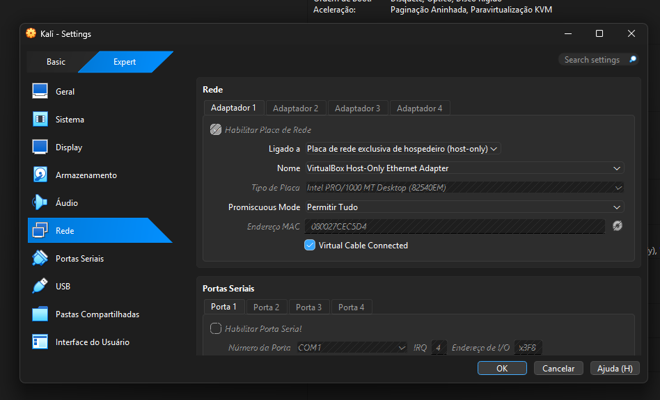
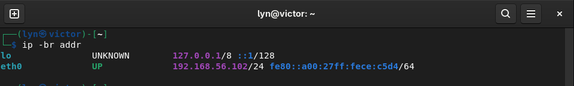
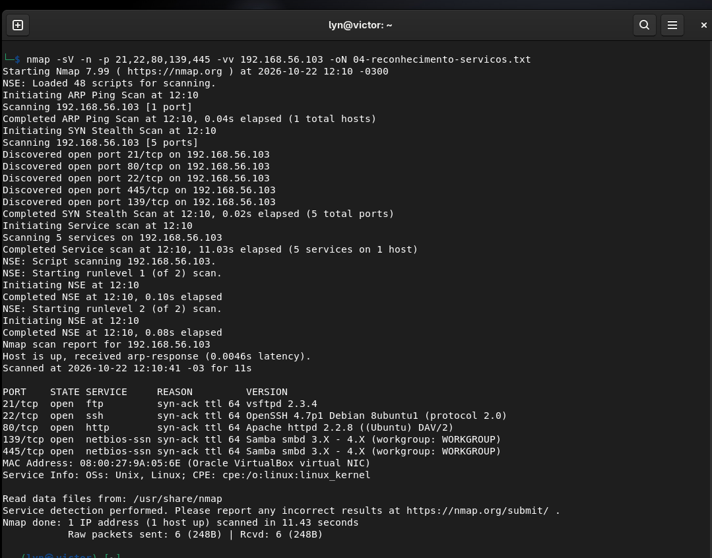

# Ambiente e reconhecimento

[Voltar ao projeto](../README.md) · [Iniciar FTP](cenarios/01-ftp.md)

## Configuração utilizada

Os testes ocorreram em duas VMs no VirtualBox, em 22 e 23 de outubro de 2026, conforme as datas visíveis nas capturas.

| Máquina | Endereço | Papel |
|---|---|---|
| Kali Linux | `192.168.56.102/24` | Origem do reconhecimento e dos testes |
| Metasploitable 2 | `192.168.56.103` | Alvo vulnerável do laboratório |

O Adaptador 1 do Kali utiliza **Placa de rede exclusiva de hospedeiro (Host-only)**, associada ao VirtualBox Host-Only Ethernet Adapter.



Host-only permite comunicação entre o hospedeiro e as VMs conectadas a essa rede virtual. Rede Interna é outro modo, com comunicação entre as VMs ligadas à mesma rede interna. Consulte as diferenças em [Redes do VirtualBox](https://docs.oracle.com/en/virtualization/virtualbox/7.2/user/networkingdetails.html).

A captura comprova um adaptador do Kali. Não foram fornecidas capturas dos demais adaptadores nem da configuração do Metasploitable. A comunicação com o alvo está evidenciada pelos testes; o isolamento integral não foi auditado.

## Preparação para repetir

Utilize VMs próprias e confirme que ambas se conectam à mesma rede de laboratório. Confira todos os adaptadores antes de ligar o alvo vulnerável e evite conexões em ponte com a rede de uso diário. Host-only não comprova, sozinho, que não existe outro caminho de rede.

Snapshots facilitam o retorno ao estado inicial. Essa é uma recomendação de repetição, não uma etapa comprovada pelas capturas.

No Kali:

```bash
ip -br addr
```



No Metasploitable, o comando sugerido foi `ifconfig`. Sua saída não foi fornecida; o IP do alvo aparece consistentemente nas conexões registradas.

## Reconhecimento dos serviços

O comando registrado na captura do Nmap é:

```bash
nmap -sV -n -p 21,22,80,139,445 -vv 192.168.56.103 -oN 04-reconhecimento-servicos.txt
```

`-sV` identifica versões; `-n` evita resolução DNS; `-p` limita a varredura às cinco portas; `-vv` aumenta os detalhes; `-oN` grava a saída em texto. Consulte o [manual do Nmap](https://nmap.org/book/man.html).



| Porta TCP | Estado | Identificação apresentada |
|---|---|---|
| 21 | open | vsftpd 2.3.4 |
| 22 | open | OpenSSH 4.7p1 Debian 8ubuntu1 |
| 80 | open | Apache httpd 2.2.8 |
| 139 | open | Samba smbd, estimativa 3.X–4.X |
| 445 | open | Samba smbd, estimativa 3.X–4.X |

A listagem SMB posterior identifica `Samba 3.0.20-Debian`. São informações reportadas por ferramentas e serviços, não inspeção dos pacotes instalados. DVWA 1.0.7 aparece no rodapé da aplicação. Medusa 2.3 e Nmap 7.99 aparecem nos terminais; versões do Kali, VirtualBox, enum4linux e smbclient não foram preservadas.

Uma porta aberta comprova a disponibilidade observada do serviço. Identificar uma versão antiga não comprova uma vulnerabilidade específica ou sua exploração.

O arquivo `-oN` não foi transferido; a saída preservada é a captura.

## Organização da entrega

Os roteiros partem da raiz deste repositório. As listas em `lab/wordlists/` foram reconstruídas das tentativas visíveis. Os comandos usam o alvo deste estudo; não são executados automaticamente ao abrir a pasta.

Siga para [FTP](cenarios/01-ftp.md), [DVWA](cenarios/02-dvwa.md) e [SMB](cenarios/03-smb.md).
