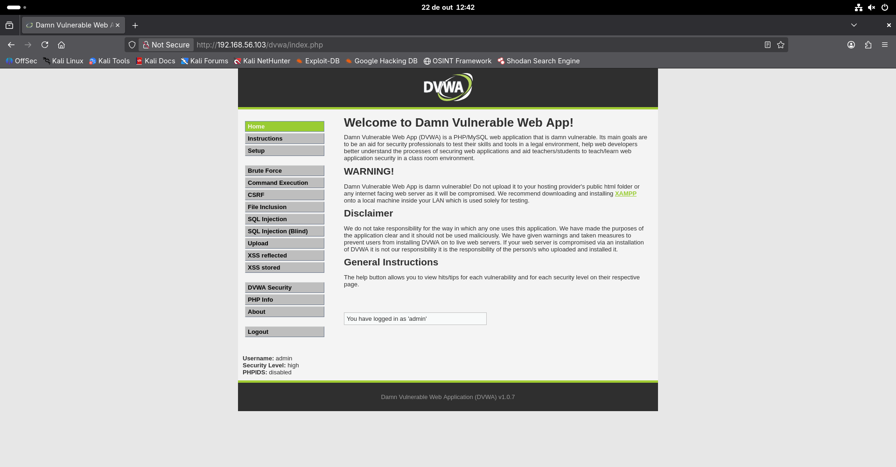
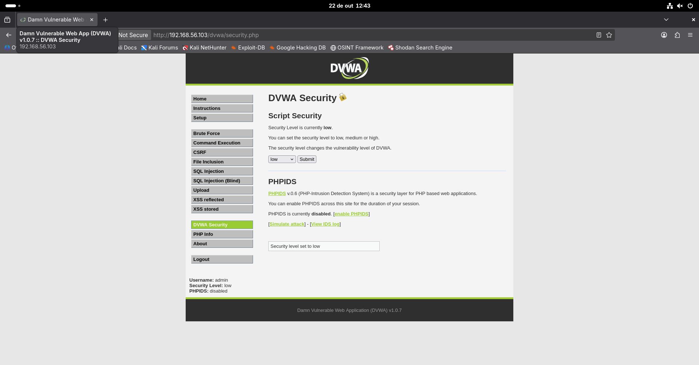
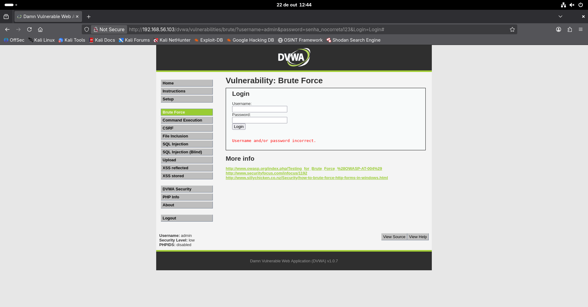

# DVWA e automação do formulário web

[Voltar ao projeto](../../README.md) · [Próximo cenário — SMB](03-smb.md)

## Objetivo e condições

Automatizar duas tentativas no formulário **Brute Force** do DVWA 1.0.7 e confirmar o resultado no navegador:

```text
http://192.168.56.103/dvwa/vulnerabilities/brute/
```

O formulário é um exercício dentro da aplicação. O teste começa com uma sessão já autenticada no DVWA. Não demonstra quebra do login principal, roubo de sessão ou acesso ao navegador de outra pessoa.

## Nível de segurança

O estado inicial era High:



Em **DVWA Security**, foi escolhido Low e acionado Submit:



A mudança prepara deliberadamente um ambiente vulnerável. A resistência de High não foi testada; ele aparece apenas como estado anterior.

## Referência de falha

Foi testado `admin` com `senha_incorreta123`:



A resposta foi `Username and/or password incorrect.`. A URL mostra os parâmetros `username`, `password` e `Login` enviados por GET. Expor a senha na URL é uma característica deste exercício antigo, não uma recomendação de implementação.

## Lista e sessão

Foi utilizada a conta `admin`. A [lista reconstruída](../wordlists/dvwa-senhas.txt) contém:

```text
senha_incorreta123
password
```

`password` é a senha padrão conhecida, incluída como controle do teste. Consulte a [documentação do DVWA](https://github.com/digininja/DVWA#default-credentials).

O cookie `PHPSESSID` veio da própria sessão do laboratório, no armazenamento do Firefox. Para repetir, copie somente o valor e guarde-o no terminal:

```bash
read -s DVWA_SESSION
echo
```

Execute a primeira linha, cole somente o valor do cookie e pressione Enter. Depois execute `echo` para iniciar uma nova linha. O valor fica invisível durante a entrada. Não inclua esse valor em arquivos versionados, capturas públicas ou atribuições literais no histórico.

## Comando registrado

Na captura, o arquivo se chamava `senha-dvwa.txt`:

```bash
medusa -h 192.168.56.103 -u admin -P senha-dvwa.txt \
  -M web-form \
  -m 'FORM:/dvwa/vulnerabilities/brute/' \
  -m 'FORM-DATA:get?username=&password=&Login=Login' \
  -m 'DENY-SIGNAL:Username and/or password incorrect.' \
  -m "CUSTOM-HEADER:Cookie: PHPSESSID=${DVWA_SESSION}; security=low" \
  -t 1 -f -O 12-dvwa-medusa.txt
```

O módulo recebe caminho, método GET, ordem dos campos e mensagem de falha. O cookie mantém a sessão e o nível escolhido. Sua ajuda foi conferida com `medusa -M web-form -q`.

Para utilizar a lista desta entrega, substitua `-P senha-dvwa.txt` por `-P lab/wordlists/dvwa-senhas.txt`. Escolha outro nome para `-O` ao repetir, pois os registros são acrescentados.

## Resultado e confirmação


A tentativa inválida aparece antes do sucesso reportado para `admin / password`. No navegador, a mesma combinação foi informada no exercício:


A mensagem exibida é:

```text
Welcome to the password protected area admin
```

Esse é o resultado confirmado. Os arquivos efetivamente recebidos numeram 12 para o terminal e 13 para o navegador; o índice segue esses nomes, não a numeração inicialmente planejada.

## Validação da resposta

O critério automatizado procura a mensagem de falha. Sua ausência em uma página inesperada, erro de sessão ou redirecionamento pode gerar falso positivo.

Por isso, a leitura do resultado combina uma senha inválida de referência, a tentativa com a senha padrão e a mensagem esperada no formulário. HTTP 200, isoladamente, não confirma autenticação.

Ao terminar, a variável local pode ser limpa:

```bash
unset DVWA_SESSION
```

## Leitura defensiva

O resultado se limita a Low, duas senhas e sessão existente. Não houve teste de MFA, políticas de bloqueio ou resistência de High. Duas tentativas não estabelecem a ausência global de limitação de taxa.

Em aplicações reais, as recomendações incluem transporte protegido, credenciais fora da URL, sessão segura e controles contra automação. Cookies e tokens CSRF não substituem limitação de tentativas ou MFA. Veja o [artigo](../../docs/fundamentos-autenticacao.md) e a [análise de prevenção](../../hardening/hardening.md).
