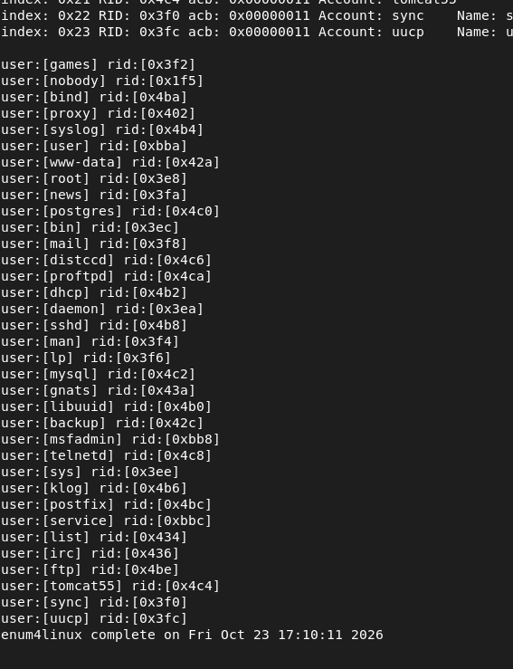

# SMB e password spraying

[Voltar ao projeto](../../README.md) · [Prevenção e próximos testes](../../hardening/hardening.md)

## Objetivo e condições

Enumerar usuários do Metasploitable 2 e verificar uma única senha em três contas. Esse arranjo ilustra **password spraying**, que distribui tentativas por várias contas.

O destino é `192.168.56.103`, com portas 139 e 445 abertas. Foram usados Medusa 2.3, módulo `smbnt`, contas locais e uma autenticação por vez.

## Enumeração

O comando utilizado durante a atividade foi:

```bash
enum4linux -U 192.168.56.103
```



A captura preserva a saída; o comando inicial está fora do recorte. Ele é registrado pelo acompanhamento da atividade, enquanto os nomes retornados são verificáveis na imagem. A opção `-U` solicita a lista de usuários, conforme a [documentação do Kali](https://www.kali.org/tools/enum4linux/).

Selecionamos três contas, preservadas em [smb-usuarios.txt](../wordlists/smb-usuarios.txt):

```text
user
service
msfadmin
```

Essa enumeração não comprova que todas as contas admitem login interativo ou possuem a mesma senha. A identidade efetiva atribuída pelo servidor à consulta não foi auditada.

## Uma rodada de spraying

A senha foi `msfadmin`, padrão conhecido do laboratório. Na VM, a lista se chamava `usuarios-smb.txt`. A captura registra:

```bash
medusa -h 192.168.56.103 -U usuarios-smb.txt -p msfadmin -M smbnt -m GROUP:LOCAL -t 1 -O 16-smb-spraying.txt
```

Para repetir a partir da raiz da entrega:

```bash
medusa -h 192.168.56.103 \
  -U lab/wordlists/smb-usuarios.txt -p msfadmin \
  -M smbnt -m GROUP:LOCAL -t 1 -O smb-reexecucao.txt
```

`-U` recebe a lista; `-p` fornece uma senha; `GROUP:LOCAL` seleciona contas locais; `-t 1` limita a concorrência. As opções foram conferidas com `medusa -M smbnt -q`.

Não foi usado `-f` ou `-F`: as três contas aparecem no resultado. Não houve outras rodadas com novas senhas ou ajuste para contornar bloqueios.

## Resultado


O sucesso é reportado para:

```text
User: msfadmin Password: msfadmin [SUCCESS (ADMIN$ - Access Allowed)]
```

É uma transcrição da imagem. O rótulo `ADMIN$ - Access Allowed` pertence à interpretação do módulo; não comprova, sozinho, administrador do sistema, root ou acesso irrestrito. Não aparece sucesso para `user` ou `service` nesta rodada.

## Verificação manual

Foi executado:

```bash
smbclient -L //192.168.56.103 -U msfadmin
```

A senha `msfadmin` foi informada no prompt.


A captura mostra `print$`, `tmp`, `opt`, `IPC$`, `ADMIN$` e `msfadmin`, sem erro de autenticação visível. O servidor se identifica como `Samba 3.0.20-Debian`.

O resultado é consistente com a indicação do Medusa e registra uma listagem com o usuário informado. Não houve abertura de compartilhamento nem leitura ou gravação. Também não foi comparado o acesso convidado para estabelecer todas as diferenças de permissão. O prompt de senha, isoladamente, não exclui esse mapeamento. A opção `-L` lista serviços; consulte o [manual do smbclient](https://www.samba.org/samba/docs/current/man-html/smbclient.1.html).

A mensagem `Reconnecting with SMB1 for workgroup listing` se refere à listagem do grupo de trabalho; ela não comprova que todas as operações anteriores negociaram SMB1.

## Leitura defensiva

Nomes de contas e senhas padrão merecem atenção conjunta. Um limite que observa apenas falhas por conta pode ter pouca visibilidade sobre uma senha tentada em vários usuários. Três tentativas, porém, não medem a capacidade real de detecção do servidor.

As recomendações são restringir o alcance do SMB, revisar enumeração, acesso convidado e permissões, substituir padrões e analisar eventos entre contas. A atualização do servidor e dos protocolos exige verificar compatibilidade.

Assinatura e criptografia SMB protegem outras propriedades do protocolo; não impedem a aceitação de uma senha válida e previsível. Veja as medidas propostas e os critérios de reteste em [Prevenção](../../hardening/hardening.md).
